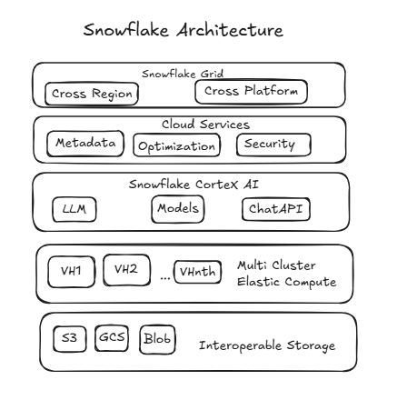

# Snowflake Architecture 



# Snowflake Architecture – 5 Key Layers

Snowflake's architecture can be understood through **five major layers**, with each layer responsible for a specific part of the data platform.

### 1. Interoperable Storage Layer

**Where your data resides**

This layer is responsible for storing data. Snowflake separates **data storage from compute**, allowing data to remain available independently of the compute resources processing it.

Snowflake can work with data stored across different cloud environments, including:

* **Amazon S3** – AWS
* **Google Cloud Storage (GCS)** – Google Cloud
* **Azure Blob Storage** – Microsoft Azure

Snowflake manages and optimizes access to the underlying storage so users can focus on querying and analyzing their data rather than managing the storage infrastructure.

---

### 2. Elastic Compute Layer

**Where your data is processed**

Snowflake uses **Virtual Warehouses** as its compute layer.

A Virtual Warehouse provides the compute resources required to:

* Execute SQL queries
* Transform data
* Load and unload data
* Perform complex data processing

The key advantage is **elasticity**. Compute resources can be scaled up or down based on workload requirements, and different warehouses can operate independently on the same underlying data.

**Simple example:**
If 100 users are querying the same data simultaneously, you can use separate or scaled compute resources without having to duplicate the underlying data.

---

### 3. Cortex / AI Layer

**Where AI capabilities are applied to your data**

Snowflake provides AI and ML capabilities through **Snowflake Cortex**, allowing organizations to work with data using AI-powered functionality.

For example, **Cortex Analyst** allows users to interact with structured business data using **natural language**.

Instead of writing:

```sql
SELECT product, SUM(sales)
FROM sales
GROUP BY product;
```

a user could ask:

> "What were the total sales for each product?"

The AI layer helps translate business questions into data-driven insights while working within Snowflake's data environment.

---

### 4. Cloud Services Layer

**The brain that coordinates Snowflake**

The Cloud Services layer manages and coordinates many of the activities happening across Snowflake.

It is responsible for capabilities such as:

* **Authentication and access control**
* **Security and governance**
* **Metadata management**
* **Query optimization and coordination**
* **Infrastructure and system management**
* **Transaction management**
* **Availability and coordination of Snowflake services**

For example, when a user submits a SQL query, the Cloud Services layer helps authenticate the request, check permissions, optimize the query, and coordinate its execution.

---

### 5. Snowflake GRID

**Connects data and workloads across regions and clouds**

Snowflake GRID is designed to provide a framework for operating Snowflake workloads across **multiple cloud providers and geographic regions**.

It supports capabilities such as:

* Cross-region data availability
* Cross-cloud data sharing and collaboration
* Replication and failover
* Business continuity and disaster recovery
* Operating data workloads across different cloud environments

**Example:**
An organization may have workloads in **AWS US**, **Azure Europe**, and **Google Cloud Asia**. Snowflake's cross-cloud capabilities help organizations manage and collaborate across these environments.

---


A simple way to remember Snowflake's architecture is:

**Storage → Compute → AI → Cloud Services → GRID**

| Layer                     | Simple Question                                   | Main Responsibility                                |
| ------------------------- | ------------------------------------------------- | -------------------------------------------------- |
| **Interoperable Storage** | Where is my data?                                 | Stores data                                        |
| **Elastic Compute**       | Where is my data processed?                       | Runs queries and workloads                         |
| **Cortex / AI**           | How can AI help me use my data?                   | AI-powered analysis and insights                   |
| **Cloud Services**        | Who coordinates everything?                       | Security, metadata, optimization, and coordination |
| **Snowflake GRID**        | How can Snowflake work across clouds and regions? | Cross-cloud and cross-region capabilities          |

### Easy way to remember

Think of Snowflake as a **modern data platform**:

**Storage** keeps your data → **Compute** processes it → **Cortex** adds AI capabilities → **Cloud Services** coordinates and governs everything → **GRID** connects workloads across clouds and regions.
